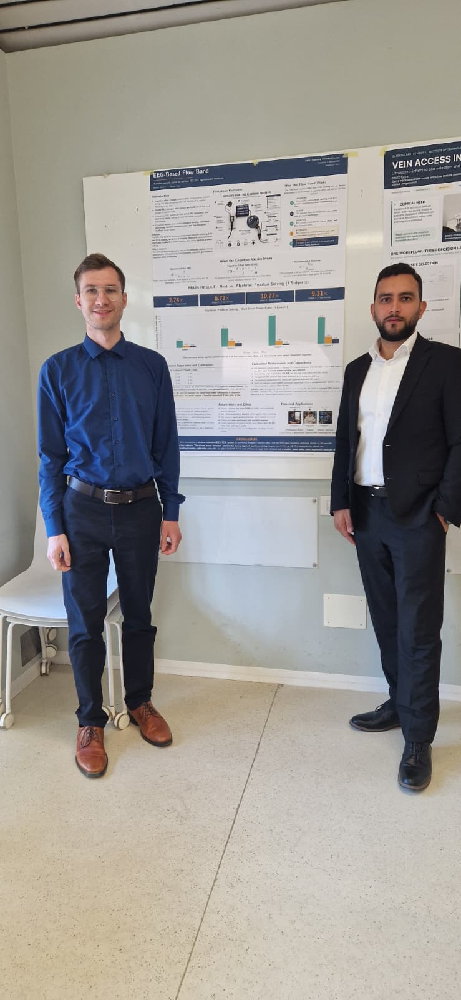
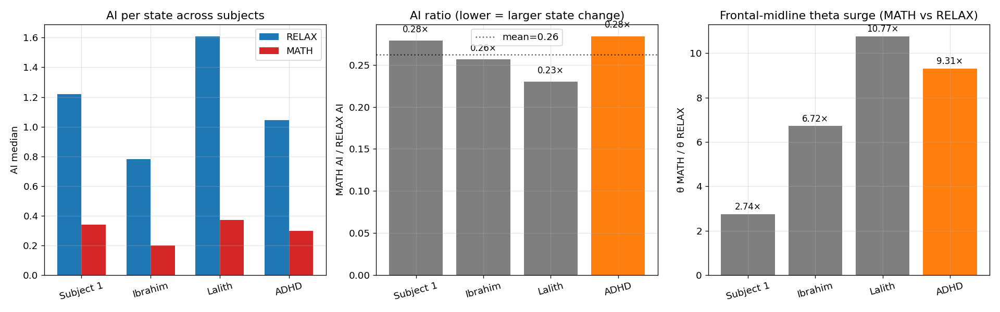
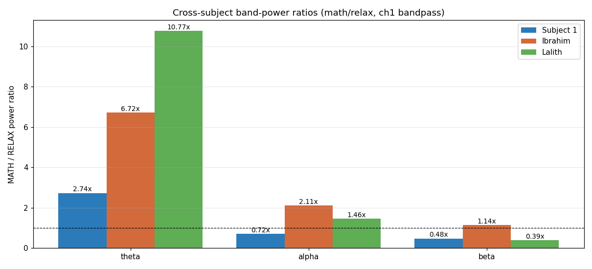
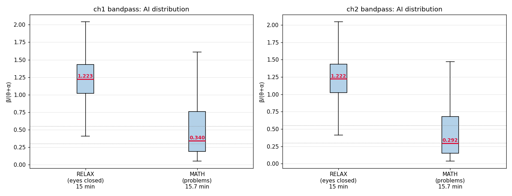
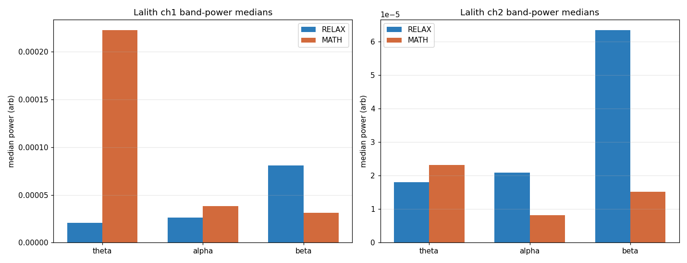
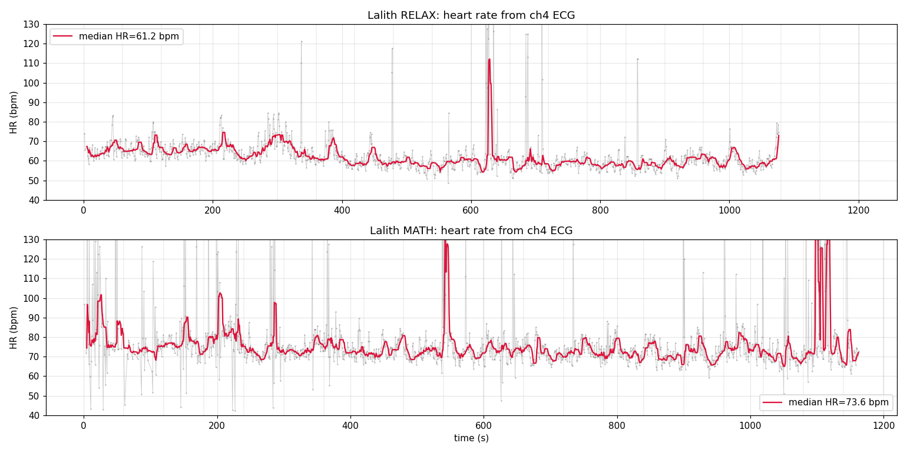
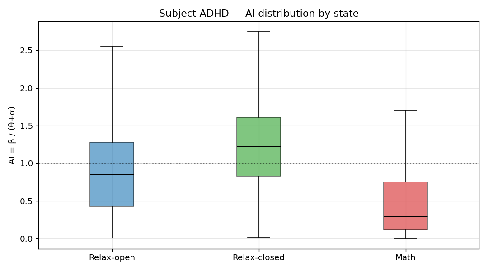
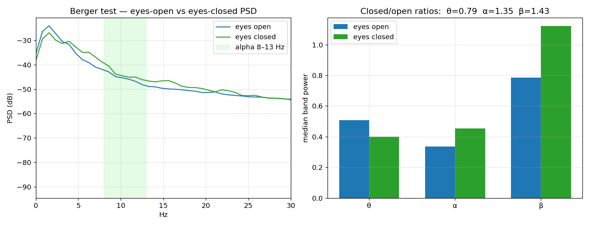
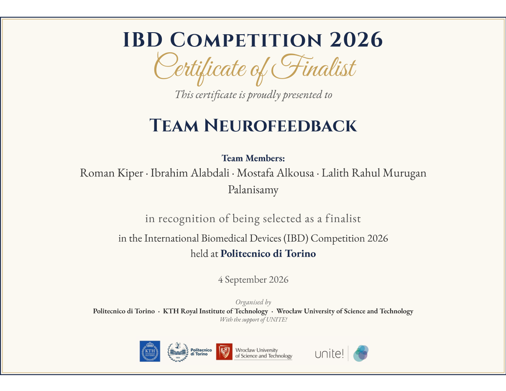

# EEG-Based Flow Band

_A small wearable that listens to your brain and heart, works out when you are focused, and nudges you when your attention drifts._

<p align="center">
  
</p>

In September 2026 we brought this project to Politecnico di Torino in Italy, where it was selected as a **finalist at the International Biomedical Devices (IBD) Competition 2026**. This page tells the story of how it works and what we found.

---

## The idea

Most EEG setups stream raw brain signals to a laptop, and the laptop does all the thinking. We wanted the opposite: a device that does the thinking **itself**, right on the body, and only reports the conclusions.

So the heart of the project is a thumb-sized microcontroller, the **Seeed XIAO nRF52840**. It sits between the sensors and the computer:

1. An **OpenBCI Ganglion** board picks up two channels of EEG from the forehead and one channel of ECG from the chest, 200 times per second.
2. The Ganglion sends these signals wirelessly to the **XIAO**, which cleans them, analyses them and decides how focused the wearer is. When focus drops, it switches on a small **vibration motor** as a gentle nudge.
3. Every 1.28 seconds the XIAO sends a short summary (attention, brain rhythms, heart rate, heart-rate variability) wirelessly to a **laptop dashboard**, which simply draws it on screen.

The XIAO is both a listener and a speaker: it _receives_ raw signals from the Ganglion and _transmits_ finished results to the PC. The raw brain data never has to leave the device.

- Device code: [blank_motor_stop/blank_motor_stop.ino](blank_motor_stop/blank_motor_stop.ino)
- Dashboard code: [pc/dashboard_receiver.py](pc/dashboard_receiver.py)

---

## What happens inside the device

### Holding on to the last moments

The XIAO keeps two short memories of the last 1.28 seconds (256 samples) for every channel. One stores the signal exactly as it arrived; the other stores the cleaned version. They work like a loop of tape: new samples keep overwriting the oldest ones. Once a fresh window of 256 samples has been collected, the device analyses it.

### Cleaning the signal

EEG is tiny (a few millionths of a volt), so it is easily drowned out by everything else. The device cleans it in three steps:

- **Removing the drift.** Sweat and electrode movement make the signal slowly wander up and down. The device subtracts the average of each window to bring it back to zero.
- **Keeping only the useful range (1–45 Hz).** A band-pass filter cuts out very slow drift below 1 Hz and fast muscle noise above 45 Hz. Brain rhythms that matter for attention all sit in between.
- **Removing mains hum (50 Hz).** Power lines in the walls produce a strong 50 Hz hum. A narrow notch filter removes exactly that frequency and leaves the rest alone.

### Listening to the brain's rhythms

Next, the device breaks the cleaned signal into its frequencies (a Fourier transform), much like separating a chord into individual notes. It then measures how strong three brain rhythms are:

| Rhythm        | Frequency | What it tends to mean                                                 |
| ------------- | --------- | --------------------------------------------------------------------- |
| **Theta (θ)** | 4–8 Hz    | Mental effort and working memory, especially in the front of the head |
| **Alpha (α)** | 8–13 Hz   | Calm, relaxed wakefulness; grows when you close your eyes             |
| **Beta (β)**  | 13–30 Hz  | Active, alert thinking                                                |

From these the device computes an **Attention Index**:

> **AI = β / (α + θ)**

It averages the index over both EEG channels and smooths it over time, so a single noisy window cannot flip the result. If the smoothed index drops below 0.35, the vibration motor switches on.

### Listening to the heart

The third channel carries the ECG. The device looks for the tall, sharp **R-peaks**, one per heartbeat. A peak only counts if it is taller than 60 % of the strongest peak in the window and at least a third of a second after the previous one (so one beat is never counted twice).

From the beats it calculates:

- **Heart rate** in beats per minute.
- **Heart-rate variability (RMSSD).** This measures how much the gap between consecutive beats changes. A healthy, relaxed heart does _not_ beat like a metronome; small beat-to-beat variations are a sign that the calming (parasympathetic) branch of the nervous system is active. The device only keeps gaps that are physiologically believable (30–200 beats per minute) and remembers the last 16 of them.

---

## The dashboard

On the laptop, a small Streamlit app connects to the XIAO, either wirelessly over Bluetooth or through a USB cable. It does no analysis of its own; it simply shows what the device has already worked out:

- big tiles with the current **attention level** (focused or distracted), **mental state**, **heart rate**, **heart-rate variability** and whether the **motor** is on;
- the strength of **theta, alpha and beta**, with how much each changed since the last update;
- live graphs of the last ~2.5 minutes;
- an optional **recording** button that saves everything to a CSV file for later analysis.

### Quick start guide

1. Open `blank_motor_stop/blank_motor_stop.ino` in the Arduino IDE, select the **Seeed XIAO nRF52840** board, install the `ArduinoBLE` and `arduinoFFT` libraries, and upload.
2. Switch on the OpenBCI Ganglion. The XIAO finds it automatically.
3. On the laptop:
   ```bash
   pip install streamlit pandas pyserial bleak
   streamlit run pc/dashboard_receiver.py
   ```
4. In the sidebar, choose Bluetooth or USB, optionally turn on recording, and press **START**.

---

## What we found: resting vs. solving maths problems

### A rough start

Our first recordings were unusable. The signal swung by up to 75,000 µV, while real brain activity is around 50 µV. Loose reference electrodes and poor skin contact were the culprits, and no filter could repair data that had been distorted before it was even recorded. The attention index got stuck at the same value whatever the person was doing.

We fixed it at the source: conductive gel, careful skin preparation, checking every electrode's contact before each session, and asking subjects to sit still with a relaxed jaw. After that, every recorded window was clean.

### The experiment

Four people were each recorded in two states, about 15–18 minutes each:

- **Rest:** sitting quietly with eyes closed.
- **Maths:** solving algebra problems in their head.

We then analysed the recordings with exactly the same settings the device uses, and compared each person **with their own resting baseline**.

| Subject     | Attention Index at rest | Attention Index during maths | Maths ÷ rest | Theta: maths ÷ rest | Resting heart rate               |
| ----------- | ----------------------- | ---------------------------- | ------------ | ------------------- | -------------------------------- |
| S1          | 1.22                    | 0.34                         | 0.28×        | **2.74×**           | 66 bpm                           |
| S2          | 0.78                    | 0.20                         | 0.26×        | **6.72×**           | 87 bpm\*                         |
| S3          | 1.61                    | 0.37                         | 0.23×        | **10.77×**          | 61 bpm, **+12 bpm** during maths |
| S4          | 1.04                    | 0.30                         | 0.28×        | **9.31×**           | 78 bpm, +3 bpm during maths      |
| **Average** | 1.16                    | 0.30                         | **0.26×**    | 7.4×                | 73 bpm                           |

\* S2's rest session came straight after maths, so their heart had not yet calmed down.


_Left: each person's attention index at rest and during maths. Middle: how much it dropped. Right: how much theta grew._

### What the numbers tell us

**1. Everyone changes by the same proportion.** People start from very different baselines, but during maths every subject's attention index fell to roughly a quarter of their resting value (0.23–0.28×, a spread of only about 9 %). The _relative_ change is what is consistent between people.

**2. One fixed threshold cannot fit everyone.** S3's resting value (1.61) is twice S2's (0.78). A single cut-off would label S2 as "focused" while they were actually resting. The device needs a short **personal calibration** at the start of each session.

**3. Theta is the brain's "effort" signal.** In every subject, theta in the front of the head rose sharply during maths, from 2.7 times up to almost 11 times the resting level. This frontal-midline theta is well known in neuroscience as a marker of concentration and working memory. Alpha and beta, by contrast, went up in some people and down in others.


_Theta rises for every subject; alpha and beta do not agree with each other._

**4. The heart tells its own story.** For S3, heart rate climbed from 61 to 74 bpm while solving problems: a clear sign of the body's "get ready" (sympathetic) response to mental stress. S4's heart barely reacted (+3 bpm), even though their brain showed a strong theta surge, so the heart and the brain give two separate views of the same effort. At rest, heart-rate variability was healthy for everyone (69–94 ms), as expected when the calming side of the nervous system is in charge.

<table>
  <tr>
    <td><br><em>S1: attention index at rest versus during maths, on both EEG channels.</em></td>
    <td><br><em>S3: theta grows almost elevenfold during maths.</em></td>
  </tr>
  <tr>
    <td><br><em>S3: heart rate rises from 61 to 74 bpm while solving problems.</em></td>
    <td><br><em>S4: eyes-open rest, eyes-closed rest, and maths.</em></td>
  </tr>
</table>

### A sanity check: closing the eyes

For S4 we split the rest session into an eyes-open half and an eyes-closed half. Almost a hundred years ago Hans Berger noticed that alpha waves grow when people close their eyes. Our device saw the same thing: alpha rose by 35 %. That tells us the system is picking up genuine brain rhythms, not just noise.



All analysis notes and figures are in [Data acquisition and stats/](Data%20acquisition%20and%20stats/).

---

## Finalists in Torino

**Team Neurofeedback**: Roman Kiper · Ibrahim Alabdali · Mostafa Alkousa · Lalith Rahul Murugan Palanisamy

Selected as finalists at the International Biomedical Devices (IBD) Competition 2026, held at Politecnico di Torino on 4 September 2026 and organised by Politecnico di Torino, KTH Royal Institute of Technology and Wrocław University of Science and Technology, with the support of UNITE!

<p align="center">
  
</p>

Certificate (PDF): [Team Neurofeedback.pdf](Team%20Neurofeedback.pdf)
